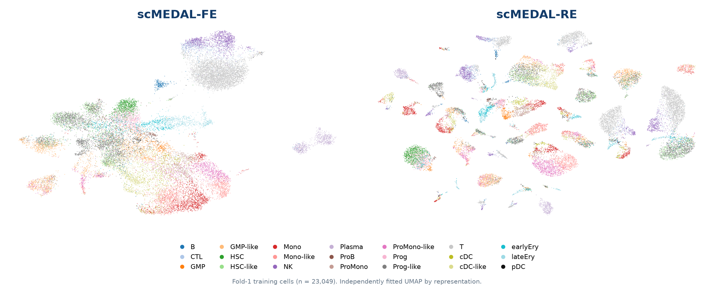
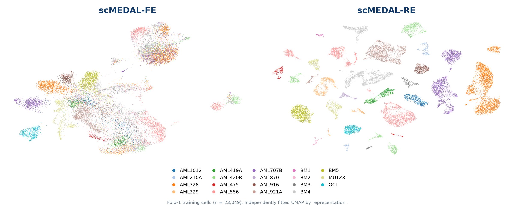
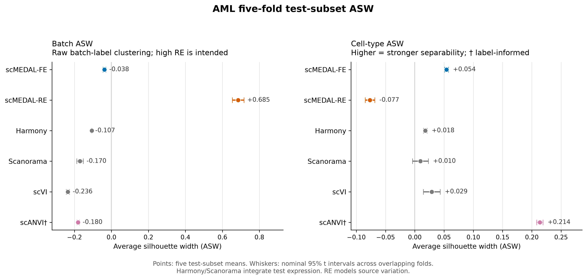

# BMI5101 Group 10: scMEDAL AML reproduction

We reproduced and evaluated the authors' scMEDAL implementation on their
preprocessed acute myeloid leukemia (AML) data. The project compares six
50-dimensional representations across five supplied cell-level folds and
examines model-generated source-condition reconstructions.

The three questions are:

1. Do FE and RE retain different source-related structure?
2. How do the six representations compare under the implemented protocol?
3. How do predicted gene patterns change across target-source conditions?


## Start here
To recalculate the public results, use a separate Python 3.12 environment:

```bash
python3.12 -m venv .venv-analysis
.venv-analysis/bin/python -m pip install -r environment/analysis-review-core.txt
.venv-analysis/bin/python reproducibility/verify_archived_results.py
```

This verifies the archived summaries without retraining or requiring a GPU.

## 1. FE and RE describe complementary source structure

Both networks reconstruct the expression input and are trained separately.
FE uses an adversarial batch classifier to reduce source-predictive information.
RE uses source-conditioned probabilistic effects and a positive batch-classifier
objective to retain source-associated structure. Neither representation is
guaranteed to isolate pure biology or pure technical noise.

The configured AML dataset contains 38,417 cells, 2,916 selected genes and 19
source labels: 12 AML donors, five controls and two cell lines. The supplied
fold-1 training coordinate tables independently confirm 23,049 cells, all 19
sources and 21 annotated cell types, with identical cell order across all seven
plotted representations (Input PCA plus six methods).

**Colored by cell type**



**Colored by source/batch**



Both figures show the same 23,049 fold-1 **training** cells. Within FE, and
within RE, cell positions are identical in the two figures: only the coloring
changes from cell type to source/batch. Here, the 19 batch labels identify the
12 AML donors, five controls and two cell lines. FE and RE have independently
fitted maps, so their axes and absolute positions are not directly comparable.
Both figures use the stored coordinates from `AML_six_methods_train_split1`.

[Patient-group coloring](results/umap/fe_re_patient_group_fold1_train.png) and
[all-method cell-type view](results/umap/all_methods_celltype_fold1_train.png).

## 2. Six-method ASW comparison

Values are mean +/- SD on the five supplied test subsets.

| Representation | Batch ASW | Cell-type ASW |
|---|---:|---:|
| scMEDAL-FE | -0.0377 +/- 0.0065 | 0.0541 +/- 0.0026 |
| scMEDAL-RE | 0.6850 +/- 0.0255 | -0.0766 +/- 0.0065 |
| Harmony | -0.1067 +/- 0.0010 | 0.0179 +/- 0.0024 |
| Scanorama | -0.1702 +/- 0.0143 | 0.0096 +/- 0.0109 |
| scVI | -0.2361 +/- 0.0071 | 0.0289 +/- 0.0116 |
| scANVI | -0.1804 +/- 0.0054 | 0.2137 +/- 0.0044 |



FE has a higher mean cell-type ASW than Harmony, Scanorama and scVI in these
runs, with modest absolute separation. RE has strong source-label structure,
consistent with its modeling objective. scANVI uses cell-type supervision.

Interpretation depends on the protocol:

- Harmony and Scanorama concatenate train, validation and test cells for
  integration. Their scored test embeddings are transductive.
- The recorded scVI/scANVI runs use log-transformed, min-max-scaled `X` with a
  ZINB likelihood. Standard count-based use ordinarily requires raw counts.
  A corrected-input benchmark would require new training.
- scVI/scANVI reserve 10% of the supplied training partition internally for
  validation. Their early-stopping procedure differs from FE/RE.
- Raw batch ASW measures label clustering. A more negative value alone does
  not establish better integration. Cell-type preservation and composition matter.
- Folds reuse sources. Nominal t intervals across overlapping folds describe
  fold variation and do not establish independent new-donor uncertainty or
  significant superiority between methods.

Source tables: [36 aggregate metric rows](results/metrics/test_metrics_long.csv),
[six-method mean table](results/metrics/test_metrics_mean.csv), and
[60 FE/RE per-fold measurements](results/metrics/fe_re_test_per_fold.csv).
All six aggregate summaries match the supplied archive. FE/RE means and SDs
were also recalculated from the fold measurements. The archive does not include
the four other methods' individual fold measurements.

## 3. Source-condition reconstructions are exploratory

The archived RE generator holds source expression `x` fixed, substitutes a
target source label and runs the complete autoencoder:

```text
r_target = RE_encoder(x, z_target)
xhat_target = RE_decoder(r_target, z_target)
```

The target label enters both encoder and decoder, so the latent is recomputed.
For each gene, we average over the selected Mono/Mono-like source cells, then
compare the average of 12 AML-target donor means with five control-target means.
The two cell lines are descriptive targets. These are model-generated as-if
associations, with disease, individual and technical contributions confounded.

- **216 of 2,916 genes (7.4%)** have the same predicted direction in all five
  source-cell folds. Target donors recur across folds.
- `SAMSN1`, `TXNIP` and `FTL` are lower under AML targets in all five folds;
  `HIST1H1D` is higher. These are exploratory model patterns.
- In fold 1, all **2,916** Mann-Whitney U tests and BH adjustments were
  recalculated from the archived target means. **Zero genes have BH-FDR < 0.05**;
  the minimum adjusted value is **0.1142**.
- `SAMSN1` changes from **-0.0713** to **-0.0565** after omitting control BM5.
  Its direction persists across all five leave-one-control-out checks, while
  magnitude depends on the sources included.

[Complete fold-1 tests and target means](results/counterfactual/fold1_test_mono_monolike/)
and [five-fold stability and donor sensitivity](results/counterfactual/fivefold_mono_monolike/).
Fold 1 uses 999 selected source cells; the five fold counts are 999, 998, 997,
999 and 996. This analysis supplies hypotheses, rather than validated biomarkers
or causal estimates.

## Additional FE weight-sensitivity records

Separate experiment notes report a single-fold pilot and five-fold validation
of adversarial weight 2. Its documented combined score (cell-type ASW minus
batch ASW) is 0.0911 +/- 0.0046, versus 0.0913 +/- 0.0066 for original FE.
The original weights (reconstruction 1000, adversarial 1) remain the benchmark.
**The supplied result ZIP does not contain the tuning score CSVs or logs.**
These remain documented summaries, with unaudited historical seed comparability.
See [the retained sensitivity record](docs/FE_WEIGHT_SENSITIVITY.md).

## Scope and reproducibility

Recorded training ran on NSCC ASPIRE 2A. Exact canonical output directories are
in [`run_manifest.json`](reproducibility/run_manifest.json); the private root is
supplied through `SCMEDAL_FORMAL_ROOT`. Training environments and the separate
analysis environment are in [`environment/`](environment/).

This work covers the authors' preprocessed AML implementation. FASTQ processing,
new-donor generalization and combined FE+RE downstream prediction are outside
the completed scope. The supplied 2025 preprint describes settings and scores
that differ from these 50-dimensional runs. Exact numerical reproduction of
every paper result has not been established. Historical training commit/patches
and the large original arrays were not supplied in this ZIP.

## Sources and repository map

- [Journal article (2026)](https://doi.org/10.1038/s41467-026-72666-4)
  and [supplied preprint version (2025)](https://doi.org/10.21203/rs.3.rs-6081478/v1).
- [Authors' code](https://github.com/DeepLearningForPrecisionHealthLab/scMEDAL_for_scRNAseq)
  and [preprocessed data/outputs](https://doi.org/10.6084/m9.figshare.28414367).
- AML source: GEO GSE116256. Upstream code/data retain their original license terms.

| Location | Contents |
|---|---|
| `reproducibility/` | Canonical run records, public-result verification, archive import, plotting and private-output wrappers |
| `results/metrics/` | Six-method aggregates and FE/RE fold measurements |
| `results/umap/` | Curated plots, aggregate cell counts and coordinate-file provenance |
| `results/counterfactual/` | Complete fold-1 gene tests, target means and five-fold sensitivity summaries |
| `results/provenance/` | Source ZIP hash, file inventory, sanitized historical manifest and recalculation report |
| `docs/` | Interpretation, reproduction workflow, experiment history and evidence boundaries |
